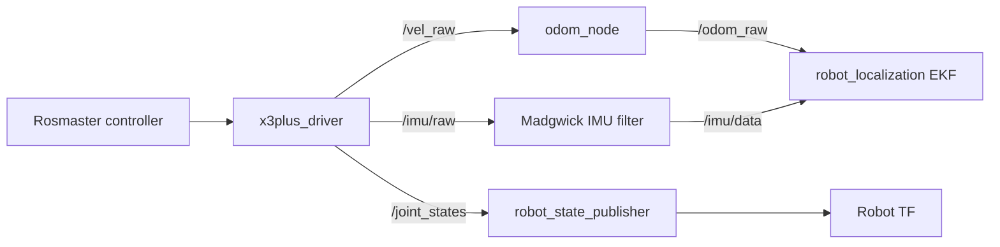

# `x3plus_bringup`

ROS 2 hardware bringup package. It connects the robot's Rosmaster controller to ROS topics and services, publishes sensor reading, joint states, and ekf-filtered odometry, and starts the robot description and state-estimation nodes.

In the larger context of this, this package provides the hardware and state interfaces used by higher-level components. 
It does not implement perception, motion planning or manipulation.

## Data flow



## Package components

| Path | Responsibility |
| --- | --- |
| `x3plus_bringup/x3plus_driver.py` | Rosmaster hardware interface; commands the base and arm, reads sensors, and publishes joint state |
| `x3plus_bringup/odom_node.py` | Integrates body-frame velocity into planar `/odom_raw` |
| `launch/x3plus_bringup.launch.py` | Starts the driver, odometry, IMU filter, EKF, robot state publisher, static camera transform, and optional camera-arm node |
| `config/x3plus_ekf.yaml` | `robot_localization` EKF configuration |
| `config/kinect_extrinsic.yaml` | Stored calibrated transform from `base_link` to `camera_base` |

## Interfaces

| Name | Type | Direction | Purpose |
| --- | --- | --- | --- |
| `cmd_vel` | `geometry_msgs/msg/TwistStamped` | Subscribed | Base velocity command forwarded to the controller |
| `TargetAngle` | `x3plus_msgs/msg/ArmJoint` | Subscribed | Arm command for a joint or an array of joint angles |
| `TrajectoryAngle` | `x3plus_msgs/msg/ArmJoint` | Subscribed | Arm joint-angle array; sent to the controller without its waypoint interpolation |
| `CurrentAngle` | `x3plus_msgs/srv/RobotArmArray` | Service | Reads arm servo angles from the controller |
| `/vel_raw` | `geometry_msgs/msg/TwistStamped` | Published | Measured planar base velocity |
| `/odom_raw` | `nav_msgs/msg/Odometry` | Published | Integrated planar odometry consumed by the EKF |
| `/imu/raw` | `sensor_msgs/msg/Imu` | Published | Raw IMU measurements |
| `/imu/data` | `sensor_msgs/msg/Imu` | Consumed | Filtered IMU input to the EKF |
| `/mag/raw` | `sensor_msgs/msg/MagneticField` | Published | Raw magnetometer measurements |
| `voltage` | `std_msgs/msg/Float32` | Published | Battery voltage |
| `/joint_states` | `sensor_msgs/msg/JointState` | Published | Wheel positions and arm command setpoints |

The driver publishes wheel positions by applying mecanum kinematics to measured
base velocity and integrating the resulting wheel rates. Arm positions in
`/joint_states` are derived from the driver's last commanded servo setpoints;
they are not continuously sampled servo feedback. The `CurrentAngle` service
separately requests the current angles from the controller.

The driver declares a `prefix` parameter for arm joint names. The odometry
node declares `linear_scale_x` and `linear_scale_y`; both default to `1.0`.
Odometry uses message timestamps, skips the first message to initialize its
time reference, and ignores non-positive time intervals. As integrated raw
odometry, it may drift and should not be considered a globally corrected pose.

## Requirements

- ROS 2 and `colcon` with the `ament_cmake` build tools.
- Yahboom X3Plus hardware and the Python `Rosmaster_Lib` controller library.
- Workspace packages `x3plus_description` and `x3plus_msgs`.
- ROS packages `robot_localization`, `imu_filter_madgwick`,
  `robot_state_publisher`, `xacro`, `tf2_ros`, and `tf_transformations`.
- `x3plus_camera_arm` is additionally required only when enabling the optional
  camera-arm node.

The controller library and the companion workspace packages are not vendored
in this package. Make sure they are available in the environment used to build
and run the workspace.

## Build

From the root of a ROS 2 workspace containing this package and its dependencies:

```bash
colcon build --packages-select x3plus_bringup
source install/setup.bash
```

## Run on hardware

> **Hardware safety:** on startup, the driver commands zero base velocity and
> sends the arm to its configured default pose. The arm may move. Clear and
> support the arm, and confirm the startup pose is safe before launching.

Start the standard bringup:

```bash
ros2 launch x3plus_bringup x3plus_bringup.launch.py
```

Start with the optional camera-arm node:

```bash
ros2 launch x3plus_bringup x3plus_bringup.launch.py enable_camera_arm:=true
```

This launch file connects to the physical Rosmaster controller; it is not a
standalone simulation launch.

## Configuration notes

- `config/x3plus_ekf.yaml` configures the EKF in 2D mode at 20 Hz. Its inputs
  are `/odom_raw` and filtered IMU data on `/imu/data`.
- `config/kinect_extrinsic.yaml` contains a calibrated `base_link` to
  `camera_base` transform.
- **The launch file does not load `kinect_extrinsic.yaml`.** It currently
  publishes a separate hard-coded translation with identity rotation. Update
  the static transform arguments in the launch file to use the calibrated
  transform before relying on camera-to-robot coordinates.
- The launch file loads `urdf/x3plus.gazebo.urdf.xacro` from
  `x3plus_description` and passes the expanded robot description to
  `robot_state_publisher`.

## Scope in the wider project

This package handles hardware communication, state publication, odometry, and
bringup. Perception, scene reconstruction, collision-aware planning, and task
execution are implemented elsewhere in the workspace. The planned manipulation
scope is an approach to a perception-derived pre-task pose; contact insertion
and fastening are outside this package's current scope.
