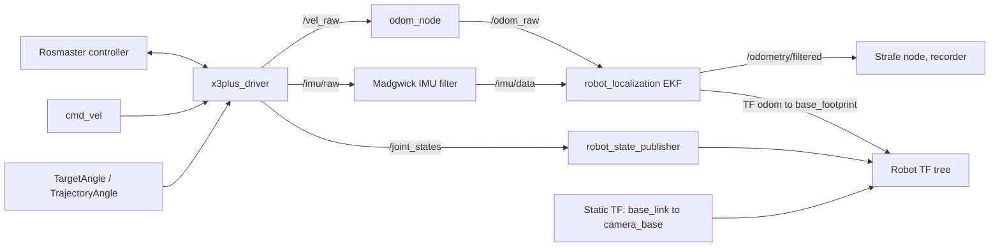

# `x3plus_bringup`

ROS 2 hardware bringup package. It connects the robot's Rosmaster controller to ROS topics and services, publishes sensor readings, joint states, and EKF-filtered odometry, and starts the robot description, state-estimation and camera transform.

The stock X3Plus software is ROS 1. Apart from two additions, the calibrated Azure Kinect
transform (`config/kinect_extrinsic.yaml`) and a separate `TrajectoryAngle` topic for
streaming trajectories, this package is a port of Yahboom's ROS 1 code to ROS 2 Humble,
without major functional changes. ROS 2 was chosen because it is the framework I had
already worked in.

In the larger context of this project, this package provides the hardware and state interfaces that the rest of the workspace depend on. It does not implement perception, motion planning or manipulation. For the project overview and scope, see the [root README](../../README.md).

## Data flow



## Package components

| Path | Responsibility |
| --- | --- |
| `x3plus_bringup/x3plus_driver.py` | Rosmaster hardware interface; commands the base and arm, reads sensors, publishes joint state |
| `x3plus_bringup/odom_node.py` | Integrates body-frame velocity into planar `/odom_raw` |
| `launch/x3plus_bringup.launch.py` | Starts the driver, odometry, IMU filter, EKF, robot state publisher, static camera transform and the optional camera-arm node |
| `config/x3plus_ekf.yaml` | `robot_localization` EKF configuration |
| `config/kinect_extrinsic.yaml` | Calibrated `base_link` to `camera_base` transform, loaded by the launch file |

## Interfaces

| Name | Type | Direction | Purpose |
| --- | --- | --- | --- |
| `cmd_vel` | `geometry_msgs/msg/TwistStamped` | Subscribed | Base velocity command forwarded to the controller |
| `TargetAngle` | `x3plus_msgs/msg/ArmJoint` | Subscribed | Arm pose command (one joint or a full array); the controller interpolates over `run_time` |
| `TrajectoryAngle` | `x3plus_msgs/msg/ArmJoint` | Subscribed | Arm joint array applied immediately, without the controller's own interpolation |
| `CurrentAngle` | `x3plus_msgs/srv/RobotArmArray` | Service | Reads the arm servo angles from the controller |
| `/vel_raw` | `geometry_msgs/msg/TwistStamped` | Published | Planar base velocity, derived from the wheel encoders by the controller |
| `/odom_raw` | `nav_msgs/msg/Odometry` | Published | Integrated planar odometry consumed by the EKF |
| `/imu/raw` | `sensor_msgs/msg/Imu` | Published | Raw IMU measurements |
| `/imu/data` | `sensor_msgs/msg/Imu` | Consumed | Madgwick-filtered IMU input to the EKF |
| `/mag/raw` | `sensor_msgs/msg/MagneticField` | Published | Raw magnetometer data (currently not used by the filter) |
| `/odometry/filtered` | `nav_msgs/msg/Odometry` | Published by EKF | Fused pose and velocity used by the rest of the pipeline |
| `voltage` | `std_msgs/msg/Float32` | Published | Battery voltage |
| `/joint_states` | `sensor_msgs/msg/JointState` | Published | Wheel positions and arm joint setpoints |

The driver declares a `prefix` parameter for arm joint names. The odometry node declares
`linear_scale_x` and `linear_scale_y` (default `1.0`).

## Design notes

**Two ways to command the arm.** `TargetAngle` only sends one pose and lets the controller interpolate
to it over the requested time. But to stream a planned trajectory, the new topic `TrajectoryAngle` was added. It sets
`run_time = 0`, so each position is applied immediately. The trajectory publisher uses it to
stream a planned trajectory at a fixed rate. Since the timing comes from the planner's samples, and the
controller's own interpolation was no longer needed.

**Joint states.** The driver integrates wheel positions from the measured base velocity using
mecanum kinematics. Arm angles are converted from servo degrees (centered on 90°) to radians, and
the gripper's servo range (30–180) is mapped to the URDF range (0–90).

**Odometry and state estimation.** Wheel encoders can't detect slip, and mecanum wheels slip,
particularly when moving sideways. The EKF (20 Hz, 2D mode) therefore fuses the wheel velocities
(vx, vy, yaw rate) with the IMU's orientation and angular velocities.The IMU passes through a Madgwick 
filter with the magnetometer disabled, so heading comes from the gyroscope. Magnetometer fusion was 
not evaluated, since gyro heading is sufficient for a short strafe. The filter's `angular_scale` 
value (1.03) is carried over from the Yahboom ROS 1 configuration and was not re-tuned; it was good 
enough for the strafe.

**Camera extrinsic.** The Azure Kinect is mounted flush on the robot's original Astra camera. The
transform between the two cameras was calibrated with a ChArUco board (see
`x3plus_perception_utils`) and combined with the known Astra mounting to give `base_link` to
`camera_base`. The result is stored in `config/kinect_extrinsic.yaml`, and initialized during launch.

## Odometry and localization for the strafe motion

Base position comes from wheel-encoder velocities integrated in `odom_node.py` and fused with the
IMU. That is enough for the current scope, where RGB-D, intrinsic and pose data are captured during a short strafe.

Limits to be aware of: nothing in the estimator measures x or y directly, so position error grows
with distance traveled. Heading is fused with the IMU gyro (no magnetometer) and drifts slowly.
Measured over the 10 cm strafe: `[fill-in measured error]`. Localizing the base to a
target position is not implemented. fusing 2D lidar scan matching into the EKF is the planned approach.

## Requirements

- ROS 2 and `colcon` with the `ament_cmake` build tools.
- Yahboom X3Plus hardware and the Python `Rosmaster_Lib` controller library.
- Workspace packages `x3plus_description` and `x3plus_msgs`.
- ROS packages `robot_localization`, `imu_filter_madgwick`,
  `robot_state_publisher`, `xacro`, `tf2_ros`, and `tf_transformations`.
- `x3plus_camera_arm` is additionally required only when enabling the optional
  camera-arm node.

The controller library and the companion workspace packages are not vendored
in this package. Make sure they are available in the environment used to build
and run the workspace.

## Build

From the root of a ROS 2 workspace containing this package and its dependencies:

```bash
colcon build --packages-select x3plus_bringup
source install/setup.bash
```

## Run on hardware

> **Hardware safety:** on startup the driver commands zero base velocity and sends the arm to its
> default pose, so the arm may move. Clear and support the arm and confirm the startup pose is
> safe before launching. The driver does not time out: the base keeps its last commanded velocity
> until a new command arrives, so be ready to stop it if the commanding node fails.

```bash
ros2 launch x3plus_bringup x3plus_bringup.launch.py
# optional: also start the arm-mounted RGB camera stream
ros2 launch x3plus_bringup x3plus_bringup.launch.py enable_camera_arm:=true
```

This launch file connects to the physical Rosmaster controller; it is not a simulation launch. It
loads `urdf/x3plus.gazebo.urdf.xacro` from `x3plus_description` for `robot_state_publisher`.

## Things to be aware of

- **Arm `/joint_states` are the last commanded angles, not servo feedback.** The servos
provide position feedback through the controller; call the `CurrentAngle` service to read
the reported servo positions. Consumers that need measured arm state should use this
service rather than `/joint_states`.
- **The strafe-and-capture poses inherit the odometry error** described above, so the quality of the reconstruction depends on it.
