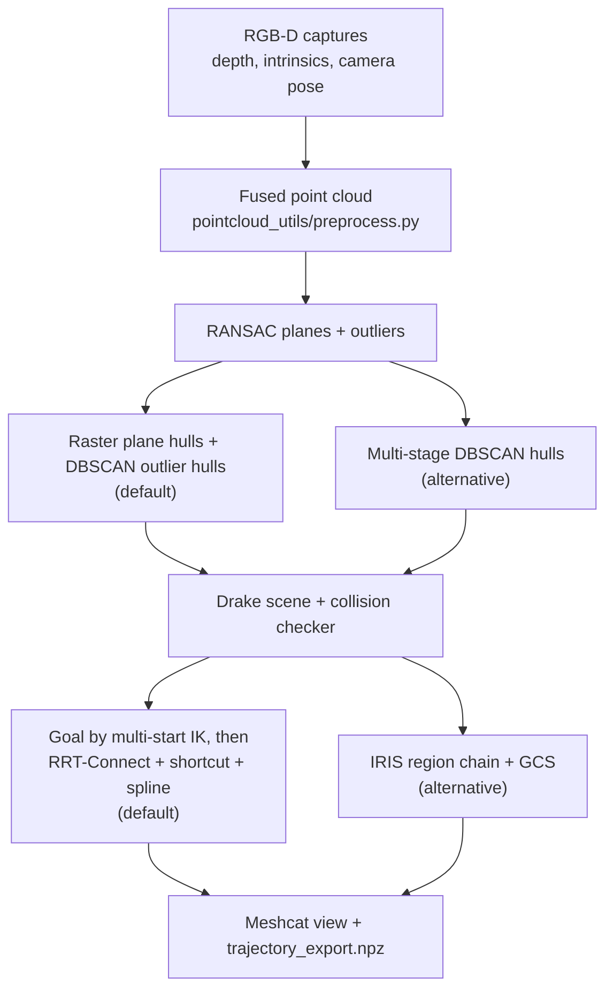

# `x3plus_drake_planner`

Collision-aware arm motion planning for the Yahboom X3Plus, built on Drake. It turns recorded RGB-D
captures into convex obstacles, builds a Drake model of the robot and those obstacles, finds a
collision-free arm configuration that reaches a target point, and plans a trajectory to it in the
arm's joint space. The output is a trajectory sampled every 0.02 s that the `x3plus_motion_planner`
streams to the arm.

The scope is an arm approach to a pre-task pose; contact, insertion and
mobile-base motion are not covered. For the project overview, see the [repository README](../README.md).

## Pipeline



**Why two planners.** The scene is rebuilt at every pose of the mobile base and because there is no CAD model the regions grown for one scene cannot be reused. For a single query, RRT-Connect is faster and simpler, taking
under a second in earlier tests against several seconds for the IRIS chains. Therefore it is the default planner now.
IRIS with GCS is kept as an alternative because it gives direct control over the trajectory cost
(path energy and time) inside a corridor of regions. It can be more applicable when there are multiple target points to address from a single capture. Performance difference in such scenario might reveal how applicable each methods are. Rightnow that is not tested yet. 

## Stages

**Point cloud (`pointcloud_utils/preprocess.py`).** Each capture's depth image is back-projected into the `odom` frame with its stored intrinsics and its recorded camera pose. Points farther than 0.6 m from the camera are dropped. Neither RRT and IRIS found no usable configurations farther out nor a fully extended arm is practical there. Each frame is downsampled to 5 mm voxels and a range of captures can be fused with a statistical filter (20 neighbours, standard
deviation ratio 2) to remove stray points.

**Collision geometry.** RANSAC (5 mm threshold, at least 1000 inliers) extracts the large planes.

- *Raster method (default, `geometry_utils/plane_rasterization.py`).* Each plane is projected to a 2D
  image with 5 mm pixels. A 3×3 opening and connected components separate physically distinct
  patches and are labelled separately, so that no points are lost. Patches that
  are not nearly convex (such as L and T shapes) are cut at their deepest notch, and every piece
  becomes a convex hull. The RANSAC outliers get one DBSCAN pass. This method separates coplanar
  objects and L-shaped patches that DBSCAN merges into one hull. The overall reconstruction looks better
  than the multi-stage DBSCAN, but I have not measured it yet.
- *Multi-stage DBSCAN (alternative, `geometry_utils/multidb.py`).* DBSCAN splits each plane into
  patches, and two more passes cluster the outliers. It is used by the IRIS and GCS script, and its
  parameters were tuned on single captures only and therefore not tuned again for fused captures.
- *TSDF and CoACD (alternative, `geometry_utils/coacd.py`).* Fuses the captures into a TSDF and
  decomposes the mesh into convex parts. It is more faithful on concave objects but much slower, so
  it is not used for planning.

Hulls are used because Drake checks collisions against convex shapes quickly, and a hull only adds
volume, which means the model can error on the side of caution. Concave objects are filled in. Points left as
DBSCAN noise are dropped.

**Drake scene (`planning_utils/drake_utils.py`).** The gripper is welded to `arm_link5`, the robot is
welded at a hand-set pose (`[0.40, 0.10, 0.0]` m in the current scripts, which also lets region and
path planning be tested from different positions), and every hull is registered as a convex collision
shape. Only the five arm joints are free (see [`x3plus_description`](../x3plus_description/README.md)),
and the first joint is limited to ±35° so planning stays in front of the robot. Self-collision is
partly filtered: adjacent link pairs and several arm and base pairs are excluded.

**Target and goal.** The target is a hand-picked world coordinate in the script, because the order of
the RANSAC planes differs between capturesat every run. A perception-selected target (a hole or an object) will
replace it. It is a position only, so the gripper's orientation is unconstrained, and the point
controlled is the `grip_joint_parent` frame, not the fingertips.

### RRT-Connect (default, `planning_utils/rrt_connect_planner.py`)

1. **Goal configuration.** `find_goal_config` solves IK from `q0` and from 30 random starts, to within
   ±1 cm in x and z and ±5 mm in y, and keeps the collision-free solution closest to `q0`. It returns
   `None` when none is found, which means the target is unreachable from this base position.
2. **Search.** Bidirectional RRT-Connect in joint space, with a step of 0.25 rad and up to 5000
   iterations, sampling inside the joint limits.
3. **Smoothing.** 100 random shortcuts, then resampling (0.1 rad, then 0.025 rad) and a cubic spline
   with continuous second derivative and zero end velocity.
4. **Timing and validation.** The spline is timed at 50% of the URDF velocity limits (1 rad/s where
   the URDF gives none) and checked for collisions at 400 sampled times. If every spline collides, it
   falls back to piecewise-linear segments, which are checked the same way.

### IRIS and GCS (alternative, `planning_utils/iris_informed.py`)

Regions are grown with IrisZo, which uses only collision-checker queries and gives a probabilistic
guarantee (`epsilon = 0.01`, `delta = 0.01`). The informed chain connects `q0` to the goal with as few
regions as possible:

1. Try IK straight to the target. If a region grown at the solution overlaps the home region, the
   chain is two regions long.
2. Otherwise, each hop bisects along the straight line to the target, solving region-constrained IK
   at each of 6 probes. If a hop gains less than 1 cm, it tries up to 15 candidates sampled in a
   prolate spheroid between the current position and the target.
3. One region is grown at the best configuration found. Since that configuration was solved inside the
   previous region, consecutive regions overlap by construction.
4. The chain ends when a region overlaps the goal region (at most 6 hops).

GCS then builds a trajectory through the chain, with each region as a quadratic Bézier region,
edges between consecutive regions, and a cost of path energy plus time under the plant's velocity
bounds. Limits: every hop must bring the gripper at least 1 cm closer to the target, and the chain
never backtracks, so a route that first has to move away from the target is not found.

## Timings

Measured on the test scene (525 collision hulls):

| Step | Time |
| --- | --- |
| Parsing the robot URDFs | 18 to 20 s per scene build, independent of the obstacles; the 153 MB base meshes are the main suspect |
| Collision checker, Drake's default 12 contexts | 4.7 s |
| Collision checker, one context (enough for RRT-Connect) | 0.84 s (0.54 s with no obstacles) |
| Goal IK and RRT-Connect planning | `[fill in]` (RRT-Connect under 1 s in earlier tests) |

Setup, not planning, dominates a visit, and simplifying the robot's collision meshes is the planned
fix. IrisZo uses the checker's extra contexts to sample in parallel, so keep the default for the IRIS
path.

## Run

```bash
cd src
python -m x3plus_drake_planner.scripts.raster_rrt_connect   # default: raster geometry + RRT-Connect
python -m x3plus_drake_planner.scripts.multidb_iris_gcs     # alternative: DBSCAN geometry + IRIS + GCS
python -m x3plus_drake_planner.scripts.tsdf_coacd           # alternative: TSDF and CoACD geometry
```

Run them as modules from `src`; running the files directly breaks the imports. The scripts read the
configured capture range from `x3plus_perception_utils/x3plus_perception_utils/rgbd_pose_dataset/chrissek_tsdf`
(currently one capture in the default script), start a Meshcat server, and write
`trajectory_export.npz` (`times`, and joint positions `q` in radians) to
`x3plus_motion_planner/trajectory`. Both planners write the same file, so the latest run is the one
the robot executes. The geometry viewer opens an Open3D window, which has to be closed for the run to
continue. Paths and planning settings are set in the scripts, not on the command line. This directory
has no `package.xml`.

Requires Drake (`[fill in: version]`) with the `manipulation` package, NumPy, OpenCV, Open3D,
Matplotlib, SciPy and scikit-learn, plus `trimesh` and `coacd` for the TSDF path. The Drake model also
needs the large OBJ meshes described in the `x3plus_description` README.

## Status and known gaps

- **The target is a hand-picked constant,** so the geometry is perception-derived but the goal is not
  yet.
- **The DBSCAN and IRIS path plans from a single capture.** Fusing a range of captures is available on
  the raster and RRT path, whose parameters were settled on it.
- **No clearance margin is applied,** and IrisZo's guarantee is probabilistic, so a margin on the
  collision checker is a sensible safeguard.
- **Points classified as noise are dropped,** so very thin or sparsely captured obstacles may be
  missing from the collision model.

## Planned

- A perception-selected target (a hole or an object) in place of the constant.
- Capturing in place at the task, with the strafe finishing there.
- A clearance margin on the collision checker.
- Simplified robot collision meshes, to remove most of the setup time.

## Reference

**Raster geometry parameters.**

| Step | Value | Why |
| --- | --- | --- |
| Pixel size | 5 mm (the voxel size) | At most one point per cell |
| Opening | 3×3 | Cuts fringe up to about 1 cm; removed pixels are labelled separately |
| Split | solidity below 0.92, notch at least 3 px, pieces at least 20 px, depth at most 6 | Removes L and T notches without over-fragmenting |
| Hull | direct hull, then ±5 mm extrusion if the patch is flat, then a box | Handles flat and collinear patches |
| Outliers | DBSCAN 0.007 and 7 points, one pass | Keeps non-planar objects |

**Multi-stage DBSCAN parameters** (metres; every value follows from the 5 mm voxel size).

| Stage | Radius | Min points | Reasoning |
| --- | --- | --- | --- |
| Voxel downsample | 0.005 | – | One point per 5 mm cube, so neighbours sit about 5 mm apart |
| RANSAC plane | 0.005 | – | Equal to the voxel size, so planes stay thin |
| Plane patches, facing the camera | 0.007 | 6 | Just above the point spacing; the count is below a regular grid's, since real captures have gaps |
| Plane patches, edge-on | 0.010 | 4 | Sparsely captured, so the radius is doubled and the count relaxed |
| Outliers, dense pass | 0.007 | 7 | Not on a plane, so more points are needed to form an object |
| Outliers, sparse pass | 0.010 | 3 | Recovers weakly captured regions; the rest is dropped |

A plane counts as edge-on when `|normal · [1, 0, 0]| < 0.2`, which assumes the camera looks along the
world x-axis.

## Scripts

| File | Role |
| --- | --- |
| `scripts/raster_rrt_connect.py` | Default: raster geometry and RRT-Connect |
| `scripts/multidb_iris_gcs.py` | DBSCAN geometry, IRIS region chain and GCS |
| `scripts/tsdf_coacd.py` | Entry point for the TSDF and CoACD alternative |
| `pointcloud_utils/preprocess.py` | Point-cloud loading, downsampling and fusion |
| `geometry_utils/plane_segmentation.py` | RANSAC plane extraction |
| `geometry_utils/plane_rasterization.py` | Raster components, splitting and plane hulls |
| `geometry_utils/multidb.py` | Multi-stage DBSCAN and hulls |
| `geometry_utils/coacd.py` | TSDF fusion, segmentation and CoACD parts |
| `planning_utils/drake_utils.py` | Drake scene, collision checker and trajectory export |
| `planning_utils/rrt_connect_planner.py` | Goal IK and RRT-Connect planner |
| `planning_utils/iris_informed.py` | Task-space-guided IRIS region chain |
| `planning_utils/iris_helper.py` | Region growth and region-constrained IK |