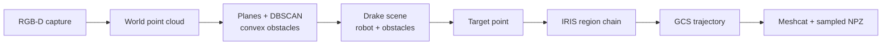
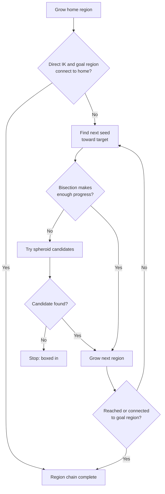

# `x3plus_drake_planner`

Collision-aware arm approach planning for the Yahboom X3Plus. Built on Drake.
It converts the `.npz` files from `rgbd_pose_dataset` into convex obstacles, builds a Drake model of the robot
and the obstacles, grows a chain of Zero-Order Iterative Region Inflation by Semidefinite programming (IRIS-ZO) 
towards a target point in the arm's C-space and uses graph-of-Convex-Sets (GCS) to find a optimized trajectory through the chain. The output is a sampled trajectory for the arm.

The current scope is to plan a trajectory for the arm to a reach a pre-task pose from the perceived collision geometry. Contact, insertion or mobile-base motion are not covered yet. For the overall project context, see the
[repository README](../README.md).

## Pipeline



## Stages and why they work this way

**Collision geometry from the point cloud (`collision_utilis.py`).** Using the `rgbd_pose_dataset` the 
depth image is projected into the world frame using the stored intrinsics and camera pose. For any given capture, distances beyond 0.6 m are considered unreachable for the arm and not included in the collision geometry reconstruction. The remaining points are voxel-downsampled. Iterative RANSAC extracts the largest planes, and 
DBSCAN splits each plane into planar patches to account for spatial seperation between coplanar points. The RANSAC
outliers and the noise from plane clustering go thorugh two more DBSCAN passes with different clustering parameters   (dense and sparse). Each cluster becomes a convex hull. 

Convex hulls are used because Drake checks collision against convex shapes quickly and when the clusters are converted to convex hulls, they can err on the side of caution. Meaning, highly concave shapes can be filled in. 
The alternative, TSDF fusion of multiple captures and convex decomposition using CoACD represents concave shapes more accurately. CoACD works by decomposing concave shape into convex segments by trading off accuracy with time vs near-instant for the DBSCAN pipleine. Since the armm only has to avoid the environment to reach the pre-task pose, the DBSCAN is the active pipeline currently.

### Parameter choices for the multi-stage DBSCAN

All distances are in metres. Every value follows from the 5 mm voxel size.

| Stage | Radius / threshold | Min points | Reasoning |
| --- | --- | --- | --- |
| Voxel downsample | 0.005 | – | One representative point per occupied 5 mm cube, so neighbouring points on a surface sit about 5 mm apart |
| RANSAC plane | 0.005 | – | Equal to the voxel size, so only points within about one voxel of a plane are inliers and the planes stay thin |
| Plane patches, facing the camera | 0.007 | 6 | Slightly above the point spacing so neighbours link up; the count is a little below what a regular grid would give, because real captures have gaps |
| Plane patches, edge-on | 0.010 | 4 | These surfaces are captured sparsely, so the radius is doubled and the count relaxed |
| Outliers, dense pass | 0.007 | 7 | These points are not on a plane, so a higher count is needed before they are treated as one object |
| Outliers, sparse pass | 0.010 | 3 | Recovers weakly captured regions from the dense pass's noise; whatever is left is dropped |

A plane counts as edge-on when `|normal · [1, 0, 0]| < 0.2`, which assumes the camera looks along the world x-axis.

**Drake scene (`drake_utilis.py`).** The gripper is welded to `arm_link5`, and each convex obstacle is
registered as collision and visual geometry. The robot can be welded into the scene at different pre-set poses (`[0.40, 0.10, 0.0]` m in the current script) and thereby region growth can be tested from different positions to the same target. Drake's `SceneGraphCollisionChecker` provides the collision queries. Self-collision is partially filtered adjacent link pairs and several other arm and base pairs are excluded, and the remaining pairs are still checked. Virtual actuators are added only to simulate Joint Space Control (JCS) but since the hardware is not torque controlled it is not used for planning.

**Target (`MultiDB.py`).** A target point is currently hand-picked rahter than from the computed plane, because plane's index diffes between run and captures. A perception based target (hole or object) selection will replace it. The target is 3D position in world space and not the robot's target pose. Rightnow only the gripper's position is constrained and the `grip_joint_parent` is the point on the gripper that is controlled. not the fingertips.

**Regions in a five-dimensional configuration space (`iris_informed.py`, `iris_helper.py`).**Only the
five arm joints are free (see [`x3plus_description`](../x3plus_description/README.md) for why). Since the robot only has 5-DOF, and considering the manipualtion task to be infront of the robot, the first joint is limited to ±35° so that regions grow forward toward the target area instead of into irrelevant space. This will be upgraded later based on where the target is and then limiting the base joint accordingly. Regions are grown with IrisZo, which uses collision-checker queries and gives a probabilistic guarantee, controlled by `epsilon = 0.01` and `delta = 0.01`, unlike IrisNp with 100% guarantee.

### The informed region chain (`iris_informed.py`)

The aim is to connect the home configuration, q0, to the goal configuration,
q_goal, with as few regions as possible. Instead of sampling the C-space
randomly, the regions are seeded relative to the target at each *hop*. A *hop*
is a C-space configuration seed between q0 and q_goal, such that growing a
region at each hop leads to a chain of overlapping regions. The steps below
describe the informed region-chain strategy.



1. **Direct attempt.** IK to the target is solved with only the joint limit constraints. If it succeeds, a goal 
   region is grown around the target and if it also overlaps with the home region then the chain is two regions long.

2. **Bisection.** From the gripper's current position, bisection along the straight line to the target
   asks how far along that line the end effector can go while the configuration stays inside the
   current region. Each of the 6 probes is an IK solve for one point on the line (±1 cm), constrained to
   the region, collision-checked and warm-started from the best configuration so far. Feasible probes
   move outward, infeasible ones move back. The result is a boundary of feasibility, not provably the
   farthest point, because feasibility along the line need not be monotone.
3. **Spheroid fallback.** If bisection gains less than 1 cm toward the target, the hop samples points in a
   prolate spheroid whose foci are the current position and the target (up to 30% longer than the direct
   path), keeps those at least 1 cm closer to the target, and tries IK for up to 15 of them, nearest to the
   target first. The first feasible one is used. If none is, the planner stops with a "boxed in" error.
4. **Growing the next region.** One IrisZo region is grown at the configuration found. Because that
   configuration was solved inside the previous region, the two regions overlap by construction.
5. **Finishing.** If the goal region is unknown, each hop first tries IK to the target from inside the
   current region, and a success ends the chain. If it is known, the chain ends as soon as the new region
   overlaps it.

Defaults: up to 6 hops, 6 bisection probes, 15 fallback candidates, 1 cm required progress per hop and a
1 cm position tolerance. A hop costs at most 22 IK solves (1 goal check, 6 probes, 15 candidates) and one
IrisZo call. Typical result on the test scene: `[fill-in]`.

Limits of the strategy: every hop must bring the gripper at least 1 cm closer to the target, and the chain
never backtracks, so a route that first has to move away from the target to get around an obstacle is not
found. The IK constrains position only, not orientation.

### Trajectory (`MultiDB.py`)

GCS is used to build the trajectory from q0 to q_goal through the regions. Each region becomes a quadratic Bézier region with start, q0 and goal, q_goal as fixed points. The order of the Bézier curve determines the smoothness in the trajectory. GCS is used because it greatly complements the IRIS regions and provides direct control over the costs (path energy, time, velocity limits apply) so the shape, speed and timing of the trajecotry are optimized. Edges are added between every region in the chain so that GCS can choose an optimial exit and entry between regions. The trajectory can be visualized in meshcat and a `0.02 s` sampled version of the same with joint positions `q` in radians is exported into `trajectory_export.npz`. `x3plus_motion_planner` publishes this directly to the hardware.

## Scripts

| File | Role |
| --- | --- |
| `MultiDB.py` | Active pipeline (multi-stage DBSCAN): one capture in, trajectory out |
| `collision_utilis.py` | RANSAC, staged DBSCAN and hulls to Drake obstacle vertices |
| `drake_utilis.py` | Drake scene, collision checker, Meshcat target markers |
| `iris_informed.py` | Task-space-guided region chain (IK, bisection, spheroid sampling) |
| `iris_helper.py` | IrisZo region growth with the seed-containment check, and region-constrained IK (the two primitives `iris_informed.py` builds on) |
| `tsdf_coacd.py` | TSDF fusion of all captures, segmentation, CoACD convex parts |
| `TSDF_CoACD.py` | Entry point for the TSDF/CoACD alternative; its planning section is commented out, so it currently builds the scene only |

## Inputs and running

```bash
cd src/x3plus_drake_planner
python MultiDB.py
```

`MultiDB.py` reads one capture, `x3plus_perception_utils/x3plus_perception_utils/rgbd_pose_dataset/chrissek_tsdf/00010.npz`,
containing `depth` (millimetres), `rgb`, `pose` and `depth_intrinsics` (`fx, fy, cx, cy, ...`). It
starts a Meshcat server and writes `trajectory_export.npz` to the current directory. Paths and planning
values, including the start configuration, are set in the script, not on the command line. The scripts
find the sibling packages by relative path, so keep the workspace layout. This directory has no
`package.xml`.

Requires Drake (`[fill in: version]`) with the `manipulation` utilities, NumPy, OpenCV, Open3D,
Matplotlib, SciPy and scikit-learn, plus `trimesh` and `coacd` for the TSDF path. The Drake model also
needs the large OBJ meshes described in the `x3plus_description` README.

## Status and known gaps

- **The target is a hand-picked constant** (see above), so the geometry is perception-derived but the
  goal is not yet.
- **Planning uses a single frame of the strafe capture.** The multi-view fusion in the TSDF path is not
  used by the active pipeline.
- **Regions are probabilistic, and no clearance margin is applied yet.**
- **Points classified as noise are dropped**, so very thin or sparsely captured obstacles may be missing
  from the collision model.
- **Timings:** `[fill-in]`.

## Planned

- A perception-selected target (a hole or an object) in place of the constant.
- Capturing in place at the task, with the strafe motion finishing there.
- A clearance margin on the collision checker.