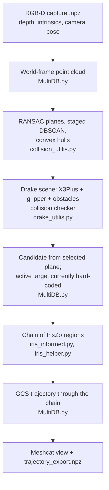

# `x3plus_drake_planner`

Collision-aware arm approach planning for the Yahboom X3Plus, built on Drake.
The active `MultiDB.py` workflow converts a captured RGB-D scene into convex
obstacles, builds a Drake model of the robot and scene, grows a connected chain
of safe regions in the arm's joint space toward an approach target, then
optimizes a trajectory through that chain with Graph-of-Convex-Sets (GCS).
The output is a sampled arm trajectory for downstream use.

This is research code. Its current scope is an arm approach to a pre-task pose;
it does not plan mobile-base motion or perform contact, insertion, or screw
fastening. For the overall project context, see the
[repository README](../README.md).

## Pipeline



## Stages and design rationale

### Point-cloud collision geometry

`MultiDB.py` back-projects depth pixels using the stored depth-camera
intrinsics, transforms points into the world frame using the recorded camera
pose, keeps points within 0.6 m, and voxel-downsamples at 5 mm. Each occupied
voxel contributes a representative point; empty voxels contribute none. The
result is therefore not a uniformly spaced point cloud, and the 5 mm voxel
size is a spatial scale for reducing density rather than a guarantee about
the spacing between retained points.

`collision_utilis.py` extracts planes with iterative RANSAC, then clusters
those plane points and the remaining points with staged DBSCAN. Convex hulls
of the resulting clusters are registered with Drake as obstacle geometry.
This favors a fast, simple collision model. A convex hull encloses its
observed cluster points, but can fill concavities and may reject otherwise
valid paths. Sparse or missing depth can still leave unobserved parts of a
physical object outside the reconstructed geometry.

The current parameter values and the reasoning behind them are:

| Stage | Current parameters | Rationale / interpretation |
| --- | --- | --- |
| Voxel downsampling | `voxel_size = 0.005 m` | Reduce point-cloud density at a 5 mm spatial scale. Only occupied voxels produce representative points, so spacing remains nonuniform and depends on the observed scene. |
| RANSAC plane fit | `distance_threshold = 0.005 m`, `ransac_n = 3`, `num_iterations = 1000`, `min_points = 1000` | The 5 mm inlier threshold is aligned with the downsampling scale and extracts dominant approximately planar structures. The threshold measures distance to a fitted plane; it does not itself select horizontal or vertical planes. |
| Plane DBSCAN, less camera-facing | `eps = 0.01 m`, `min_points = 4` | Relaxed clustering is intended to retain patches on surfaces with sparser returns, including surfaces oriented edge-on to the camera path. |
| Plane DBSCAN, more camera-facing | `eps = 0.007 m`, `min_points = 6` | Tighter clustering is intended for denser plane observations, separating spatially distinct patches without joining them across larger gaps. |
| Primary non-planar/outlier DBSCAN | `eps = 0.007 m`, `min_points = 7` | A denser-neighborhood requirement groups locally supported structure; RANSAC outliers and points rejected as noise by plane DBSCAN are combined for this pass. |
| Secondary outlier DBSCAN | `eps = 0.01 m`, `min_points = 3` | A relaxed final pass attempts to recover sparse structures from the primary pass's noise. Points still labeled as noise are left out of the obstacle hulls. |

The segmentation is deliberately staged rather than treating all points with
one clustering setting. RANSAC first identifies the large planar structures.
DBSCAN then separates each plane into spatial patches, using different
neighborhood and support requirements for denser, more camera-facing returns
and sparser, edge-on returns. Plane-clustering noise is not immediately
discarded: it is recombined with the RANSAC outliers and passed through a
tighter, higher-support clustering pass, followed by a looser pass that can
recover smaller or more sparsely observed groups. The intent is to preserve
reliable large surfaces while still giving weaker observations a later
opportunity to form obstacle clusters.

In the implementation, that orientation split uses the absolute dot product
between the normalized plane normal and `camera_normal` (default `[1, 0, 0]`):
below `0.2` uses the relaxed settings; otherwise it uses the tighter settings.
RANSAC itself is not constrained to horizontal or vertical planes. The
parameters are engineering heuristics based on the expected capture density
and setup, with the DBSCAN radii chosen at and above the voxel scale; the
resulting point spacing and clusters are still scene-dependent. Validate the
geometry against representative captures before treating it as a safety
guarantee.

An alternative in `tsdf_coacd.py` fuses multiple depth frames into a TSDF mesh,
segments it into clusters, and uses convex hulls or CoACD convex decomposition
for collision pieces. It can represent concave shapes with multiple convex
parts, at greater processing cost. The current choice of the single-capture
hull pipeline is intended for quick obstacle construction while testing
approach planning; comparative speed or fidelity claims should be supported
by measured results on the same data and machine.

### Drake scene and configuration space

`drake_utilis.py` loads the Drake-specific X3Plus and gripper URDFs, welds the
base at `[0.40, 0.10, 0.0]` m in the planning world, welds the gripper base to
`arm_link5`, adds obstacle geometry, and creates Drake's
`SceneGraphCollisionChecker`. The base offset is currently an experimental
scene-registration value used to test planning against the same capture from
different simulated base placements. It is not a calibrated robot-to-camera
extrinsic or localization estimate.

Only the five arm joints are free in the Drake model; the base, wheels, and
gripper joints are fixed. This keeps IRIS's configuration space focused on
the joints being planned. The first arm joint is further restricted to ±35°
in the active `MultiDB.py` domain to bias the search toward the work area.
Virtual arm actuators are added to the Drake plant for simulation experiments;
they are not hardware controllers and are not used by the planner.

Selected neighboring and other self-collision pairs are filtered in
`drake_utilis.py`. This is a partial self-collision model, not exhaustive
self-collision checking. The gripper is fixed at its modeled extended
configuration, and a grasped object is not included in the collision model.

### Target point

`compute_target_point()` can derive a candidate approach point from the
centroid and normal of a selected segmented plane, applying a surface offset
and a hand-tuned vector. In the active `MultiDB.py`, the selected plane index
is fixed at the third detected plane, and the computed point is then replaced
with a fixed world-frame coordinate. This avoids reselecting a target by trial
and error for the current experiment, but it means the active goal is **not**
automatically selected from perception.

The target is a point, not a full end-effector pose: the gripper orientation is
unconstrained, and the position constraint applies to the origin of
`grip_joint_parent`, not the fingertips. Selecting a hole, part, or other
task-relevant target from perception is future work.

### IRIS region chain

`iris_informed.py` uses task-space guidance to find a sequence of
configurations toward the target, while `iris_helper.py` provides the
region-growth primitives and a simpler sampling-based chain. The informed
approach is intended to reduce wasted exploration compared with uninformed
sampling in configuration space:

1. Attempt IK directly to the target within the joint-limit domain.
2. If the goal region does not connect to the home region, bisect along a
   task-space line to the target, solving IK constrained to the current
   region.
3. If bisection fails to make the required 1 cm progress, try task-space
   candidates sampled inside a prolate spheroid between the current gripper
   position and the target.
4. Grow an IRIS region at each accepted configuration and stop when the chain
   reaches the goal region or the hop limit is exceeded.

Constraining each bridge IK solution to the current convex region makes the
bridge configuration belong to that region. The next region is explicitly
checked to contain its seed, so consecutive regions share that seed when
growth succeeds. This addresses seed connectivity; it does not by itself
prove that the geometric model captures every real-world collision.

The active script sets IrisZo sampled-region options `epsilon = 0.01` and
`delta = 0.01`. These are algorithm parameters, not a physical clearance
distance or a deterministic safety margin. The region-constrained IK helper also adds a 1 mm minimum
distance lower bound. That IK constraint is distinct from
the IRIS region-growth sampling settings; neither should be described as
guaranteeing zero collision risk on hardware. A larger clearance constraint
could be evaluated as a robustness margin, but it would need to be chosen and
validated against perception error, calibration error, geometry fidelity, and
the robot's actual dimensions.

### GCS trajectory optimization

Each safe region is added as an order-2 Bézier region in Drake's
`GcsTrajectoryOptimization`; fixed start and goal points anchor the path. The
current graph connects the regions as a single chain. GCS therefore does not
choose among multiple routes in this configuration, but it still optimizes a
continuous trajectory through the corridor, using path-energy and time costs
subject to the plant's velocity limits. If future planning creates multiple
overlapping region branches, the graph can express route alternatives as
well.

The trajectory is visualized in Meshcat and sampled at 0.02 s to
`trajectory_export.npz`. The file contains `times` and `q`, the arm joint
positions in radians, for use by the downstream trajectory publisher in
`x3plus_motion_planner`. This package plans and exports a trajectory; it does
not execute it on the robot.

## Scripts

| File | Role |
| --- | --- |
| `MultiDB.py` | Active single-capture RANSAC/DBSCAN hull pipeline, informed IRIS region chain, GCS trajectory, Meshcat visualization, and NPZ export. |
| `collision_utilis.py` | RANSAC plane extraction, staged DBSCAN clustering, convex hull generation, and conversion to Drake obstacle vertices. |
| `drake_utilis.py` | Drake robot/scene construction, collision checker, collision filters, and target markers. |
| `iris_informed.py` | Task-space-guided region chain using constrained IK, bisection, and informed spheroid sampling. |
| `iris_helper.py` | IRIS seed containment check, region-constrained IK, sequential sampling alternative, and region animation. |
| `tsdf_coacd.py` | Multi-capture TSDF fusion, mesh segmentation, and convex obstacle generation with hull/CoACD processing. |
| `TSDF_CoACD.py` | TSDF/CoACD entry script. Its trajectory-planning section is commented out, so it currently builds the reconstructed scene but does not run IRIS/GCS or export a trajectory. |

## Inputs and running

Run from the workspace's `src` directory in the configured Drake environment:

```bash
cd src/x3plus_drake_planner
python MultiDB.py
```

`MultiDB.py` currently reads
`x3plus_perception_utils/x3plus_perception_utils/rgbd_pose_dataset/chrissek_tsdf/00010.npz`.
The capture is expected to contain `depth` in millimetres, `rgb`, `pose`, and
`depth_intrinsics` (`fx, fy, cx, cy, ...`). The active input path, target,
start configuration, and planning settings are hard-coded in the script, not
provided as command-line options. The scripts locate sibling packages by
relative path, so the expected workspace layout must be preserved. This
directory is a collection of Python scripts and has no `package.xml`.

The TSDF helper accepts a directory of captures. The checked-in
`TSDF_CoACD.py` entry point points to the same `chrissek_tsdf` dataset
directory. Capture NPZ files are not included in the repository; provide the
data locally or link it from the project overview when a shareable dataset
location is available.

Requirements include Drake (`pydrake`) and its `manipulation` utilities,
NumPy, OpenCV, Open3D, Matplotlib, SciPy, and scikit-learn. The TSDF/CoACD path
also uses `trimesh` and `coacd`. The Drake URDF requires the large OBJ base
meshes described in [`x3plus_description`](../x3plus_description/README.md);
those files are excluded from Git and must be provided locally or replaced
with available geometry.

## Current evaluation and limitations

- **Planner comparison:** task-space guidance is intended to reduce IRIS
  exploration, but region counts and timings should be reported from repeated
  runs on the same scenes and machine. Compare against RRT-Connect using the
  same start, goal, collision geometry, and success criteria before drawing
  performance conclusions.
- **Single-capture active path:** `MultiDB.py` currently uses one capture.
  The robot base placement is manually offset in the planning world so the
  same scene can be used to examine behavior from different simulated spawn
  positions. Multi-view strafe captures are handled by the TSDF alternative,
  not the active hull pipeline.
- **Target selection:** the current plane index is fixed, and the active target
  is a hard-coded point. A perception pipeline that identifies a
  task-relevant hole, object, or color is future work.
- **Registration and perception uncertainty:** the fixed robot base offset,
  recorded camera pose, camera extrinsics, and reconstructed obstacles all
  affect relative robot-scene placement.
- **Collision-model coverage:** convex hulls can over-approximate concavities;
  sparse or occluded observations can under-represent physical objects.
  Self-collision filtering is partial, and held objects are not modeled.
- **Contact task:** plans stop at a pre-task approach point. Contact control,
  insertion, fastening, and mobile-base planning are outside the current
  scope.

Planning time, region count, and collision-checking results are intentionally
not claimed here without a documented, repeatable evaluation setup.
