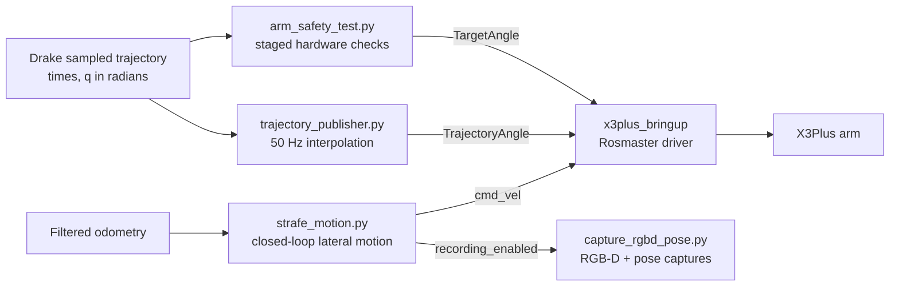
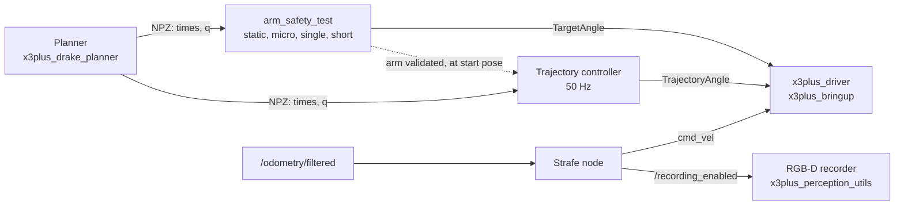

# `x3plus_motion_planner`

Motion execution package for the X3Plus robot. It contains nodes to validate step by step planned arm trajectory on the hardware, stream the complete trajectory to the hardware and execute a lateral strafe motion when capturing of `rgbd_pose_dataset` has begun. This package only executes what the planner computes, trajectory planning is executed in [`x3plus_drake_planner`](../x3plus_drake_planner/README.md), interface to arm is provided by [`x3plus_bringup`](../x3plus_bringup/README.md) and saving `rgbd_pose_dataset` is done in [`x3plus_perception_utils`](../x3plus_perception_utils/README.md). For the project overview, see the [repository README](../README.md).

## Data flow





## Nodes

| Script | Node | Purpose |
| --- | --- | --- |
| `trajectory_publisher.py` | `arm_trajectory_controller` | Loads sampled Drake trajectory data, interpolates the five arm-joint positions at a fixed rate, converts them to servo angles, and streams them to `TrajectoryAngle`. |
| `arm_safety_test.py` | `arm_safety_test` | Provides static, single-joint, first-waypoint, and reduced-waypoint tests before attempting full trajectory playback. |
| `strafe_motion.py` | `ekf_mecanum_strafe_node` | Executes a fixed left-right-center strafe using filtered odometry and signals the RGB-D recorder to start and stop. |

## Trajectory format and arm command conventions

The trajectory publisher expects a NumPy `.npz` file containing:

- `times`: one-dimensional sample times in seconds.
- `q`: an `N x 5` array of arm joint positions in radians, in the order
  expected by the Drake model and the downstream servo mapping.

At each tier callback, the publisher linearly interpolates each joint between
neighboring samples. It converts radians to servo degrees using
`degrees(q) + 90`, appends the current sixth servo angle (the gripper) from
the `CurrentAngle` service, and publishes an `x3plus_msgs/msg/ArmJoint` on
`TrajectoryAngle` with `run_time = 0`. In the `x3plus_bringup/x3plus_driver.py`, this topic sends
each waypoint directly to the controller without a separate timed
interpolation by the ROSMASTER. The trajectory publisher runs at 50 Hz by default and shutsdown after sending the final sample.

**`NOTE:`** The servos provide position feedback, available through the
`CurrentAngle` service. During playback, the publisher requests feedback
without blocking the command loop, compares each returned arm-angle reading
with the desired trajectory position associated with that request, and saves
the readings and errors to `trajectory_error.csv` in the current directory.
Service requests are serialized, so the comparison sampling rate depends on
the service response time and may be lower than the command rate. At completion,
the publisher reports per-joint MAE, RMSE, and maximum absolute error in degrees.
The CSV's signed error is measured servo angle minus desired servo angle;
desired and measured positions are also included in radians. Set the
`error_file` parameter to change the output path. This is monitoring only: it
does not adjust commands or stop playback when an error is large. Confirm the
arm's starting pose and servo mapping before
running a trajectory. At startup the driver sets the arm to the default
configuration which is always used by Drake as the initial configuration
during trajectory planning.

## Hardware checks with `arm_safety_test.py`

The safety-test node waits for the `CurrentAngle` service even in `static`
mode. Its `mode` parameter defaults to `static`. It queries and reports the
current angles without sending a movement command. The `static` is set as default to ensure that each test is performed consciously as a fail safe against directly jumping to `single` or `short`. Once tested, the `trajectory_export.npz` doesn't need to be tested again unless there is change in the trajectory format.

| Mode | Behavior |
| --- | --- |
| `static` | No arm movement; checks access to `CurrentAngle`. |
| `micro` | Adds 2 servo degrees to one selected arm joint, then commands it back to its recorded starting angle. `test_joint` is numbered 1–5. |
| `single` | Loads a trajectory and commands its first `q` sample as a single target, using a 400 ms controller interpolation. |
| `short` | Plays every sixth trajectory sample, with a timed command for each reduced-rate waypoint. |


## Strafe and RGB-D capture

`strafe_motion.py` waits for `/odometry/filtered`, records the first received pose as its local reference, then commands lateral targets of +0.10 m, -0.10 m, and 0 m relative to that starting pose. Thus the middle motion travels across the center to 0.10 m on the other side. It publishes body-frame `TwistStamped` message to `cmd_vel` at 50 Hz and uses filtered yaw to compensate for heading changes.

The node publishes `true` and `false` on `/recording_enabled` at the start and end of its sequence. To save captures, launch the driver file under `Azure_Kinect_ROS_Driver` and the `x3plus_perception_utils/capture_rgbd_pose.py` as well. Make sure TF is available between the recorder's world and camera frames (published by `x3plus_bringup`). The recorder defaults to saving in `x3plus_perception_utils/rgbd_pose_dataset/latest`.

**`NOTE:`** This motion is soley executed to get multiple captures to do a local reconstruction of the scene. The safety needs to manually monitored, therefore make sure to have enough empty area for the robot to move.  The next section of this project, mobile motion planning and localization will replace this temporary strafe motion.


## Interfaces

| Name | Type | Direction | Used by |
| --- | --- | --- | --- |
| `CurrentAngle` | `x3plus_msgs/srv/RobotArmArray` | Service client | `trajectory_publisher.py`, `arm_safety_test.py` read the current servo-angle array. |
| `TrajectoryAngle` | `x3plus_msgs/msg/ArmJoint` | Published | `trajectory_publisher.py` streams direct trajectory positions; consumed by `x3plus_bringup`. |
| `TargetAngle` | `x3plus_msgs/msg/ArmJoint` | Published | `arm_safety_test.py` sends timed test poses; consumed by `x3plus_bringup`. |
| `cmd_vel` | `geometry_msgs/msg/TwistStamped` | Published | `strafe_motion.py` commands the mobile base through `x3plus_bringup`. |
| `/odometry/filtered` | `nav_msgs/msg/Odometry` | Subscribed | `strafe_motion.py` obtains the base pose and heading. |
| `/recording_enabled` | `std_msgs/msg/Bool` | Published | `strafe_motion.py` starts/stops `capture_rgbd_pose.py`. |

The package uses ROS 2 Python (`rclpy`), NumPy, `x3plus_msgs`, and standard ROS
message packages including `geometry_msgs`, `nav_msgs`, and `std_msgs`. Hardware
operation additionally requires the X3Plus bringup stack and, for capture,
the camera and perception-recorder dependencies.


## Build

> **Hardware safety:** trajectory feedback is monitored but does not adjust commands or stop the
> arm if tracking error is large. The base keeps its last commanded velocity if the node commanding it crashes (the driver has no timeout; interrupting the
> strafe node with Ctrl-C does stop the base). Clear the workspace around the arm and base, start
> with the smallest test, and be ready to cut power.

Start `x3plus_bringup`, then validate a trajectory in order, and run it:

```bash
colcon build --packages-select x3plus_motion_planner
source install/setup.bash

ros2 run x3plus_motion_planner arm_safety_test.py --ros-args -p mode:=micro -p test_joint:=2
ros2 run x3plus_motion_planner arm_safety_test.py --ros-args -p mode:=single
ros2 run x3plus_motion_planner arm_safety_test.py --ros-args -p mode:=short

ros2 run x3plus_motion_planner trajectory_publisher.py
```

For the strafe capture, start the RGB-D recorder first, then the strafe node:

```bash
colcon build --packages-select x3plus_motion_planner x3plus_perception_utils
source install/setup.bash

ros2 run x3plus_motion_planner capture_rgbd_pose.py
```
