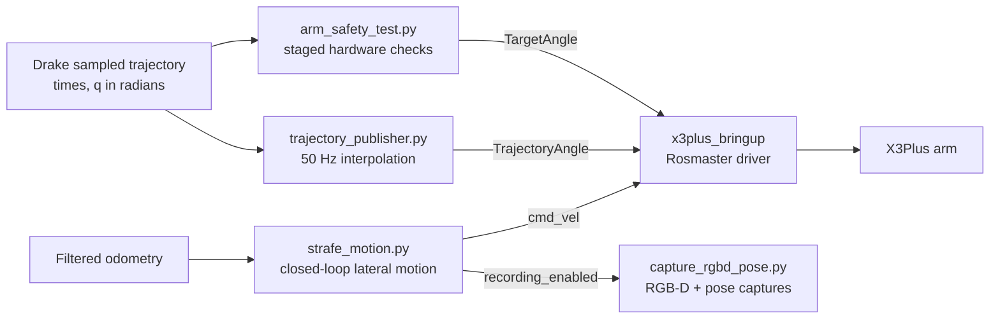

# `x3plus_motion_planner`

Motion execution package for the X3Plus robot. It contains nodes to validate step by step planned arm trajectory on the hardware, stream the complete trajectory to the hardware and execute a lateral strafe motion when capturing of `rgbd_pose_dataset` has begun. This package only executes what the planner computes, trajectory planning is executed in `x3plus_drake_planner`(../x3plus_drake_planner/README.md), interface to arm is provided by `x3plus_bringup`(../x3plus_bringup/README.md) and saving `rgbd_pose_dataset` is done in `x3plus_perception_utils`(../x3plus_perception_utils/README.md). For the project overview, see the [repository README](../README.md).

ROS 2 Python nodes for validating and publishing planned arm trajectories on
the Yahboom X3Plus, plus a closed-loop lateral strafe node used to collect
RGB-D captures at different base positions. The package connects the Drake
trajectory output to the arm interface provided by
[`x3plus_bringup`](../x3plus_bringup/README.md). It does not generate
collision geometry or plan trajectories itself.

For the wider project context, see the [repository README](../README.md).

## Data flow



## Nodes

| Script | Node | Purpose |
| --- | --- | --- |
| `trajectory_publisher.py` | `arm_trajectory_controller` | Loads sampled Drake trajectory data, interpolates the five arm-joint positions at a fixed rate, converts them to servo angles, and streams them to `TrajectoryAngle`. |
| `arm_safety_test.py` | `arm_safety_test` | Provides static, single-joint, first-waypoint, and reduced-waypoint tests before attempting full trajectory playback. |
| `strafe_motion.py` | `ekf_mecanum_strafe_node` | Executes a fixed left-right-center strafe using filtered odometry and signals the RGB-D recorder to start and stop. |

## Trajectory format and arm command conventions

The trajectory publisher expects a NumPy `.npz` file containing:

- `times`: one-dimensional sample times in seconds.
- `q`: an `N x 5` array of arm joint positions in radians, in the order
  expected by the Drake model and the downstream servo mapping.

The Drake planner currently writes `trajectory_export.npz`; the publisher's
default filename is `trajectory_export_minjerk.npz`. Pass `traj_file` to select
the file you intend to execute.

At each control tick, the publisher linearly interpolates each joint between
neighboring samples. It converts radians to servo degrees using
`degrees(q) + 90`, appends the current sixth servo angle (the gripper) from
the `CurrentAngle` service, and publishes an `x3plus_msgs/msg/ArmJoint` on
`TrajectoryAngle` with `run_time = 0`. In the bringup driver, this topic sends
each waypoint directly to the controller without a separate timed
interpolation. The trajectory publisher runs at 50 Hz by default and sends
the final sample before shutting down.

The publisher reads the current servo-angle array to preserve the gripper
position. It does not compare the current arm position with the trajectory's
first sample, measure trajectory tracking error, or provide a feedback
controller. Confirm the arm's starting pose and servo mapping before running a
trajectory.

## Hardware checks with `arm_safety_test.py`

The safety-test node waits for the `CurrentAngle` service even in `static`
mode. Its `mode` parameter defaults to `static`, which queries and reports the
current angles without sending a movement command.

| Mode | Behavior |
| --- | --- |
| `static` | No arm movement; checks access to `CurrentAngle`. |
| `micro` | Adds 2 servo degrees to one selected arm joint, then commands it back to its recorded starting angle. `test_joint` is numbered 1–5. |
| `single` | Loads a trajectory and commands its first `q` sample as a single target, using a 400 ms controller interpolation. |
| `short` | Plays every sixth trajectory sample, with a timed command for each reduced-rate waypoint. |

Examples:

```bash
# No-motion service check
ros2 run x3plus_motion_planner arm_safety_test.py

# Small motion on arm joint 1
ros2 run x3plus_motion_planner arm_safety_test.py --ros-args \
  -p mode:=micro -p test_joint:=1

# Move to the first trajectory waypoint
ros2 run x3plus_motion_planner arm_safety_test.py --ros-args \
  -p mode:=single -p traj_file:=/absolute/path/to/trajectory_export.npz

# Play the reduced-waypoint trajectory test
ros2 run x3plus_motion_planner arm_safety_test.py --ros-args \
  -p mode:=short -p traj_file:=/absolute/path/to/trajectory_export.npz
```

These are staged checks, not a collision-safety guarantee. Start with `static`,
then validate a small motion with the robot supported and the workspace clear
before testing trajectory waypoints.

## Full trajectory playback

Start the robot bringup and verify that the arm and controller are ready.
Inspect the trajectory file, joint order, units, and initial configuration;
keep the robot's motion envelope clear and remain able to stop execution.
Then run:

```bash
ros2 run x3plus_motion_planner trajectory_publisher.py --ros-args \
  -p traj_file:=/absolute/path/to/trajectory_export.npz \
  -p control_hz:=50.0
```

Parameters:

| Parameter | Default | Meaning |
| --- | --- | --- |
| `traj_file` | `trajectory_export_minjerk.npz` | Path to the input trajectory file, resolved relative to the process working directory unless absolute. |
| `control_hz` | `50.0` | Rate at which the node samples and publishes the trajectory. |

The node waits for `CurrentAngle`, loads the file, streams commands on
`TrajectoryAngle`, sends the endpoint, then shuts down. The arm driver accepts
these commands directly; this node does not verify that the physical arm
reached each commanded position.

## Strafe and RGB-D capture

`strafe_motion.py` waits for `/odometry/filtered`, records the first received
pose as its local reference, then commands lateral targets of +0.10 m, -0.10 m,
and 0 m relative to that starting pose. Thus the middle leg travels across the
center to 0.10 m on the other side. It publishes body-frame `TwistStamped`
commands to `cmd_vel` at 50 Hz and uses filtered yaw to compensate for heading
changes.

The node publishes `true` and `false` on `/recording_enabled` at the start and
end of its sequence. To save captures, run the RGB-D camera and the
`x3plus_perception_utils` recorder as well, with TF available between the
recorder's world and camera frames. The recorder defaults to saving in
`tsdf_dataset`; its output directory can be configured on that node.

Default strafe parameters:

| Parameter | Default | Meaning |
| --- | --- | --- |
| `kp_linear` | `1.5` | Proportional gain for planar position error. |
| `kp_angular` | `2.0` | Proportional gain for heading error. |
| `linear_tolerance_m` | `0.01` | Lateral position tolerance for advancing to the next target. |
| `max_linear_speed` | `0.15` | Maximum commanded linear speed in m/s. |
| `max_angular_speed` | `0.25` | Maximum commanded angular speed in rad/s. |

**Known issue to check before using the strafe node on hardware:** when a
lateral target is reached, the current implementation calls
`publish_twist(0.0, 0.0, v_omega)`. Since the function arguments are
`(angular_z, vx, vy)`, this places the heading correction in lateral velocity
instead of angular velocity for that control tick. The heading-hold behavior
at the target should not be relied on until this is corrected.

## Interfaces

| Name | Type | Direction | Used by |
| --- | --- | --- | --- |
| `CurrentAngle` | `x3plus_msgs/srv/RobotArmArray` | Service client | `trajectory_publisher.py`, `arm_safety_test.py` read the current servo-angle array. |
| `TrajectoryAngle` | `x3plus_msgs/msg/ArmJoint` | Published | `trajectory_publisher.py` streams direct trajectory positions; consumed by `x3plus_bringup`. |
| `TargetAngle` | `x3plus_msgs/msg/ArmJoint` | Published | `arm_safety_test.py` sends timed test poses; consumed by `x3plus_bringup`. |
| `cmd_vel` | `geometry_msgs/msg/TwistStamped` | Published | `strafe_motion.py` commands the mobile base through `x3plus_bringup`. |
| `/odometry/filtered` | `nav_msgs/msg/Odometry` | Subscribed | `strafe_motion.py` obtains the base pose and heading. |
| `/recording_enabled` | `std_msgs/msg/Bool` | Published | `strafe_motion.py` starts/stops `capture_rgbd_pose.py`. |

The package uses ROS 2 Python (`rclpy`), NumPy, `x3plus_msgs`, and standard ROS
message packages including `geometry_msgs`, `nav_msgs`, and `std_msgs`. Hardware
operation additionally requires the X3Plus bringup stack and, for capture,
the camera and perception-recorder dependencies.

## Build

From the workspace root, after installing the package's ROS dependencies:

```bash
colcon build --packages-select x3plus_motion_planner
source install/setup.bash
```

For hardware use, make sure the message package and bringup nodes are built in
the same workspace. For example:

```bash
colcon build --packages-select \
  x3plus_msgs x3plus_bringup x3plus_motion_planner
source install/setup.bash
```

Add `x3plus_perception_utils` to the build when using the strafe node with its
RGB-D recorder.
